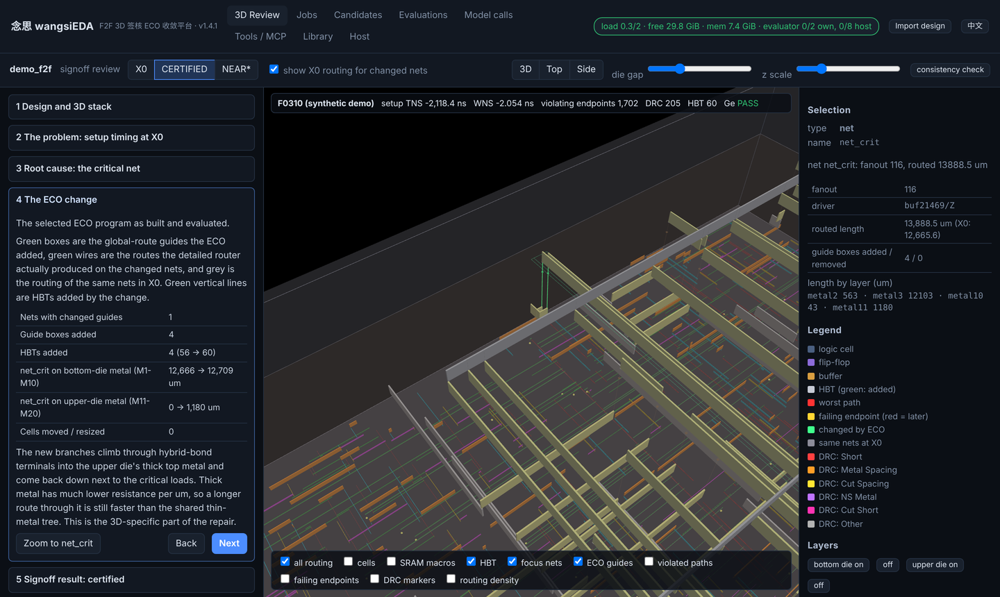

# wangsiEDA (念思)

English | [中文](README.zh-CN.md)

[](https://github.com/wangsi34/wangsiEDA/actions/workflows/ci.yml)
[](CHANGELOG.md)
[](https://www.python.org/)
[](LICENSE)

Version 1.5.1 · MIT · Python 3.9+, standard library only · no front-end dependencies

**A signoff-driven ECO closure platform for face-to-face (F2F) 3D ICs.** It wraps the tools you have already validated
(ECO builder, signoff evaluator, STA readback, signoff gates) into one service that schedules, records and explains every
step: durable job engine, LLM agents behind deterministic guards, a 3D signoff review, a natural-language console and an MCP interface.



wangsiEDA does not re-implement place-and-route or STA. Design data, EDA tools and model calls stay on your compute host;
your laptop only needs a browser (and an SSH tunnel for a remote host).

> **What is in this repository.** The platform itself (job engine, agents, guards, gates, 3D viewer, console, MCP server),
> the block RTL-to-GDS flow on open-source tools, and a synthetic demo. The F2F **ECO builder and signoff evaluator are not
> included**: ECO evaluation and closure run only after you plug in your own (see [Install on a Linux compute host](#install-on-a-linux-compute-host)
> and [docs/配置参考.md](docs/配置参考.md)). Without them you can still use the demo, the block flow and the DEF/LEF viewer.

## Try the demo first (no private data needed)

On macOS or Linux (on Windows, inside [WSL](https://learn.microsoft.com/windows/wsl/install)), open a terminal in the extracted project directory containing `wangsi.py` and run the following command with Python 3.9+. Viewing the bundled design requires only Python and a browser.

```bash
python3 wangsi.py demo
```

(`python3 wangsi.py demo --package OUT` instead writes a double-click offline copy, `OUT/打开念思.html`, that opens in any
browser without Python.)

This generates a small **synthetic** F2F design (placement, routing on both dies, hybrid-bonding terminals, violated paths,
DRC markers, a candidate pool, judged evaluations and one finished closure job), starts the console on this machine and opens
the browser. Demo data lives in `cloud/demo_root/` and never touches a real installation; the header shows a "demo data" tag.

Keep the terminal open while viewing the demo. If the browser does not open automatically, copy the full URL printed by the launcher, including `?token=…`. The demo defaults to port `18766`. If that port is busy, run `python3 wangsi.py demo --port 18767`. Press Ctrl+C in the terminal to stop the service.

On macOS, the console shows “—” for available memory and the host-wide evaluator process count. You can still explore the 3D review and the completed example job. To run new EDA jobs, follow the Linux compute host instructions below.

What to look at:
- **3D review**: a seven-step walkthrough from the problem (a high-fanout shared net) to the ECO (a dedicated cross-tier
  branch through two new HBTs) to the signoff verdict, plus a certified state and a near miss to compare.
- **Jobs**: the DAG, timeline, agent reasoning, guard decisions and gate verdicts of a closure job.
- **Candidates and states**: gate bounds, the signoff landscape, the candidate pool and every evaluation.
- **Ask wangsiEDA** (top right): needs a model key, see below.

## What it does

| Module | Description |
|---|---|
| Catalog | Read-only index of your existing results (`RESULT.json` / `REJUDGE.json`), signed-off states, candidate ECO programs and model-call ledger, in SQLite |
| Tools | 29 tools with JSON schemas, a side-effect class (read / compute / runtime / llm / asset), a scheduling pool, timeout and retry policy |
| Job engine | Dynamic DAG; every step is a separate worker process in its own directory; state in SQLite; running steps are re-attached after a restart; timeout, retry, cancel, per-step retry |
| Pools ("licenses") | evaluator / openroad / build / llm / cpu; the evaluator pool counts every evaluator process on the host and has a load / disk / memory admission gate |
| Flows | `eco_eval` (one candidate through build, evaluator, readback, gates), `eco_closure` (agent plan, critic, parallel evaluations, reflection), `block_flow` (block RTL to GDS with closed-loop repair), `ask` (one console question) |
| Agents | ECO planner (ReAct over read-only tools), reflector, RTL debug, physical-design diagnosis, console assistant; every output goes through guards |
| Gates | Envelope gate **Ge** and exact gate **Gs**: setup WNS, hold TNS/WNS, total DRC, Short, Cut-Short, wirelength, HBT excess, per-clock latency/skew, optional area and instance count. Missing metrics fail |
| 3D review | WebGL2 viewer built from evaluator outputs: every routed segment and via per layer, both dies, HBTs, violated paths, DRC, guide diff; consistency check against DEF and reports |
| Ask wangsiEDA | Natural-language questions answered from read-only tools; may suggest one job, which you submit with a click |
| MCP | stdio JSON-RPC: read-only tools run directly, the rest are submitted as jobs |
| UI | Chinese / English |

## Safety design

- **Validated tools are never edited.** wangsiEDA runs path-derived copies and records how each was derived (source SHA-256).
- **No replay.** A candidate program that was ever measured is never evaluated again.
- **Own namespace.** All writes go to the platform directory and a `wangsi/` namespace under the evaluator runtime directory.
- **Agents propose, guards decide.** Type / range / whitelist checks, frozen contracts (clock period, testbench SHA-256), no
  repeated configurations, resume-point correction, per-job call budgets. The console assistant cannot submit anything.
- **A result counts only if every gate passes**, and only gate-certified lessons are reused automatically.
- **Local only.** The service binds to 127.0.0.1 and every request needs a per-install token.
- **No secrets in the repository.** `wangsi_config.json`, your prompts, `*.env`, `var/`, `jobs/`, `derived/` are ignored by git.

## Install on a Linux compute host

```bash
# on your laptop
export WANGSI_HOST=<ssh alias of the compute host>
export WANGSI_REMOTE=/path/on/host/wangsieda
python3 wangsi.py deploy        # copies cloud/, runs the self-test, restarts the service, prints the install report
python3 wangsi.py up            # starts the service if needed, opens an SSH tunnel and the console
```

Then on the host:

```bash
cd $WANGSI_REMOTE
cp wangsi_config.example.json wangsi_config.json   # fill in what you have; every feature is optional
bin/wangsictl doctor                               # what works, what is missing, and how to fix each item
bin/wangsictl freeze-tb rv_alu                     # freeze the example block's testbench
```

`doctor` reports four features independently:

| Feature | Needs |
|---|---|
| ECO evaluation and closure | `design_registry_module`, `eco_builder_module`, `gate_bounds_json`, `normalized_states_json`, `runtime_dir`, `cases` (your own tools; see [docs/配置参考.md](docs/配置参考.md) for the interfaces) |
| 3D signoff review | `platform_dir` (tech and cell LEFs), `x0_runs` (evaluator output of the initial state) |
| Block RTL to GDS | Yosys, Icarus Verilog, Verilator (`oss_cad_bin`), OpenROAD (`openroad_env`), `nangate45_dir` |
| LLM agents | `WANGSI_LLM_API_KEY` and `WANGSI_LLM_BASE_URL` in the environment, or `llm_env_file` (chmod 600); `llm_model`. Any OpenAI-compatible `/chat/completions` endpoint |

The ECO builder and evaluator are **not** part of this repository: wangsiEDA drives the ones you already trust. Without them
you still get the DEF/LEF viewer, the block flow and the demo.

## Agent prompts

Built-in prompts for all five agents ship in `cloud/prompts/default/` in three variants: A (minimal), B (structured rules),
C (rules plus one worked example). Your own `prompts/<name>.txt` always takes precedence. Defaults were chosen with a real
model (DeepSeek `deepseek-flash`, thinking mode high, about 300 calls): planner B, reflector C, RTL debug B, physical C,
assistant B. Data and reasons: [docs/提示词评测.md](docs/提示词评测.md).

Compare prompts on fixed synthetic scenarios with the real agent code and guards, in a throw-away database:

```bash
bin/wangsictl prompt-eval                       # all agents, variants A/B/C
bin/wangsictl prompt-eval --agents assistant --repeats 2
bin/wangsictl prompt-eval --prompt-file eco_planner=prompts/eco_planner.txt   # score your own prompt
./run_prompt_eval.sh                            # same, on your laptop; asks for the key without storing it
```

## Ask wangsiEDA

The button at the top right opens a chat. Examples: "What is the best certified result on bp_fe?", "Which program should I
evaluate next?", "Why did yesterday's job fail?". The assistant answers only from read-only tools (designs, candidates,
evaluations, jobs, host) and replies in your language. If an evaluation would help it suggests one job; the suggestion is
checked (job kind and parameter whitelist, candidate in the pool and never measured, flow checks, no clock changes) before it
is shown as a button, and nothing runs until you click and confirm. Each question is an `ask` job with a full trace.

## Tests

```bash
cd cloud && python3 -m unittest discover tests   # gates, parsers, schemas, fresh-install behaviour, prompt-eval scoring
bin/wangsictl selftest                           # tools, guards, MCP; judge vs stored verdicts when ECO assets are configured
python3 -m wangsieda.prompt_eval --mock good     # evaluator sanity check without a model
```

CI runs the unit tests on Python 3.9 to 3.13, the mock prompt evaluation, a JavaScript syntax check and a demo smoke test.

## Documentation

| Document | Content |
|---|---|
| [README.zh-CN.md](README.zh-CN.md) | Project overview, local demo, and setup instructions (Simplified Chinese) |
| [docs/配置参考.md](docs/配置参考.md) | Every configuration key, gate fields, evaluator output convention, external module interfaces (Chinese) |
| [docs/部署与运维.md](docs/部署与运维.md) | Deployment, systemd, operations, backup, upgrades (Chinese) |
| [docs/接口参考.md](docs/接口参考.md) | HTTP API, MCP, 3D scene format (Chinese) |
| [docs/提示词评测.md](docs/提示词评测.md) | Prompt evaluation results (Chinese) |
| Module guides | [`wangsieda`](cloud/wangsieda/README.md) · [`tools`](cloud/wangsieda/tools/README.md) · [`ui`](cloud/wangsieda/ui/README.md) · [`prompts`](cloud/prompts/README.md) · [`blocks`](cloud/blocks/README.md) · [`tests`](cloud/tests/README.md) |
| [CHANGELOG.md](CHANGELOG.md) · [SECURITY.md](SECURITY.md) · [CONTRIBUTING.md](CONTRIBUTING.md) · [THIRD_PARTY_NOTICES.md](THIRD_PARTY_NOTICES.md) | |

## License

MIT, see [LICENSE](LICENSE). Third-party notices in [THIRD_PARTY_NOTICES.md](THIRD_PARTY_NOTICES.md).
